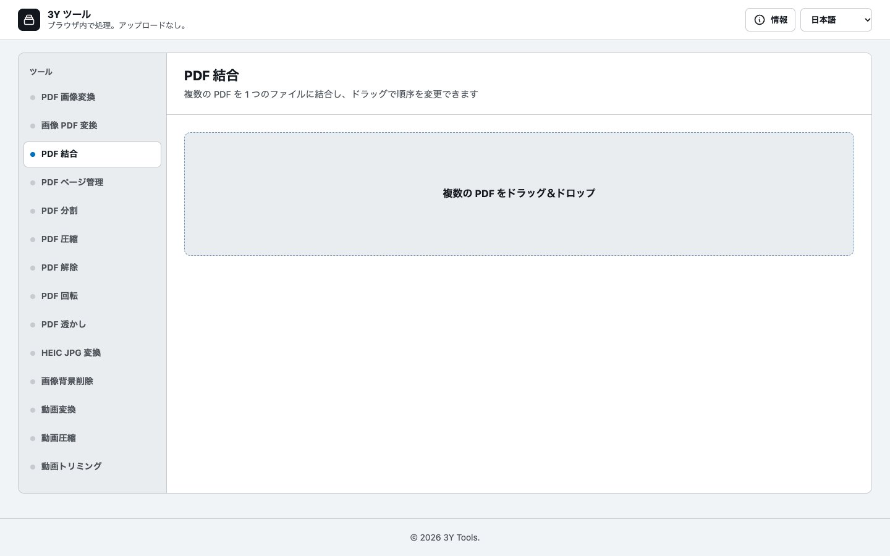

# 3Y ツールボックス（YYPDFTools）

<p align="center">
  <strong>ブラウザだけで動作する、プライバシー重視の PDF・画像・動画ツール</strong>
</p>

<p align="center">
  <a href="README.md">繁體中文</a> ｜ <a href="README.en.md">English</a> ｜ 日本語
</p>

<p align="center">
  
  
  
</p>

**[3Y ツールボックスを開く](https://yenyuy.github.io/YYPDFTools/)** · インストール不要で、ブラウザからすぐに使えます。



## 概要

3Y ツールボックスは、PDF、画像、動画を扱うシングルページのユーティリティ集です。選択したファイルは端末内に残り、変換・結合・圧縮・トリミング・出力はすべてブラウザ内の JavaScript で実行されます。ファイルをバックエンドサーバーへアップロードする必要はありません。

日常的な文書処理にすぐ使えるほか、静的サイトとしてそのまま公開できます。繁体字中国語、英語、日本語に対応し、OS の設定に合わせてライト／ダークテーマを自動で切り替えます。

## 機能

| ツール | 内容 | 出力 |
| --- | --- | --- |
| PDF 画像変換 | PDF の各ページを JPG または PNG に変換 | 画像または ZIP |
| 画像 PDF 変換 | 複数の JPG／PNG を 1 つの文書に結合 | PDF |
| PDF 結合 | 複数の PDF を結合し、ドラッグで順序を変更 | PDF |
| PDF ページ管理 | ページのプレビュー、並べ替え、削除。編集の取り消しや元のページ構成への復元が可能 | PDF |
| PDF 分割 | シンプルな 2 分割・ページ分割に加え、ページプレビューと複数の出力範囲を設定可能 | PDF または ZIP |
| PDF 圧縮 | ページをラスタライズし、選択した画質で PDF を再構築 | PDF |
| PDF 解除 | 既知のパスワードを使って、保護されていない PDF を再構築 | PDF |
| PDF 回転 | 回転後の表示をページごとに確認し、全ページを時計回りに 90°、180°、270° のいずれかに回転 | PDF |
| PDF 透かし | 文字のスタイル、角度、配置を設定し、ページごとにプレビュー。全ページまたは指定ページへの適用と、黒い矩形やブラシでの墨消しに対応 | PDF |
| HEIC JPG 変換 | 1 枚または複数の HEIC／HEIF 写真を JPG に変換 | JPG |
| 画像背景削除 | ブラウザ内 AI で自動削除し、消去／復元ブラシで調整 | 透明 PNG |
| 動画変換 | MP4、WebM、MOV、MKV、AVI、TS、GIF、一般的な音声形式へ変換 | 動画、GIF、音声 |
| 動画圧縮 | 画質、解像度、H.264／H.265／VP9 を指定して圧縮 | MP4 または WebM |
| 動画トリミング | 動画をプレビューし、正確な時間範囲を切り出し | MP4 |

PDF の透かしはサンセリフ、セリフ、等幅フォントに対応し、端末のフォントを使って中国語や日本語などの文字を描画します。単一位置または繰り返し配置を選び、繰り返しの間隔や適用するページも設定できます。墨消しがない場合、透かしは画像レイヤーとして追加され、元の文書で選択・検索できる文字は保持されます。処理はすべてローカルで行われます。

ページのプレビューは閲覧モードで始まります。黒い矩形やブラシに切り替え、マウスまたはタッチで機密情報を手動で墨消しできます。ブラシサイズも調整できます。墨消しはページ移動やモード切り替え後も保持され、削除するまで出力に適用されます。ページごとに元に戻す・全削除が可能です。いずれかのページに墨消しがある場合、ダウンロード時に透かしを描画してから不透明な黒で覆い、全ページを画像化して新しい PDF を作成します。元のテキスト層、注釈・フォームのオブジェクト、添付ファイル、メタデータはコピーされず、出力文書の文字は選択・検索できなくなります。

インターフェースの特徴：

- 繁体字中国語、English、日本語を即時切り替え
- ドラッグ＆ドロップとファイル選択の両方に対応
- ライト／ダークテーマを自動適用
- 進行状況、完了通知、対処方法が分かるエラーメッセージ
- キーボードフォーカス、セマンティックなタブ、動的ステータス通知
- ワイド画面ではウィンドウ幅に合わせて作業領域が広がり、モバイルにも対応

## プライバシーと処理方式

ファイルの内容はすべて、現在開いているブラウザタブ内で処理されます。アップロード API はなく、アカウント登録も不要です。

初回表示時はインターネット経由で CDN からフロントエンドライブラリを読み込みます。オフライン環境で運用するには、PDF.js のワーカー、背景削除モデル、FFmpeg の WebAssembly コアなど、必要に応じて読み込まれるファイルもローカルに用意する必要があります。

背景削除機能は初回利用時に約 40 MB の AI モデルを追加でダウンロードします。モデルはブラウザにキャッシュされ、画像データがモデル配信元や他のサーバーへ送信されることはありません。

動画ツールは初回処理時に約 32 MB の FFmpeg WebAssembly コアをダウンロードします。動画データはブラウザ内の一時ファイルシステムだけに書き込まれ、処理後に削除されます。

> [!IMPORTANT]
> 「PDF 圧縮」と「PDF 解除」は、各ページを画像化してから PDF を再構築します。ブラウザだけで処理できますが、出力文書の文字は選択・検索できなくなります。解除機能は、元のパスワードが分かっていて、ブラウザの PDF エンジンがその文書を読み取れる場合に限り利用できます。

## 使い方

1. ツールボックスを開き、ツールメニューから使いたい機能を選びます。
2. ファイル選択エリアをクリックするか、そのエリアにファイルをドラッグ＆ドロップします。
3. 必要に応じて形式、ページ範囲、画質、パスワード、回転角度を設定します。
4. 処理を開始し、完了後に結果をダウンロードします。ブラウザが対応する形式はプレビューでも確認できます。

### PDF ページ管理

1. サムネイルをドラッグして並べ替えるか、タッチ操作やキーボードで **前へ移動** または **後ろへ移動** を選びます。
2. サムネイルを選択するとページが表示され、**プレビューを拡大** でダイアログが開きます。どちらのプレビューでも表示中のページを移動・削除できます。
3. **元に戻す** または **元のページに戻す** で編集を取り消せます。少なくとも 1 ページは残してください。
4. **編集した PDF をダウンロード** を選ぶと、現在のページ順で別のファイルに保存されます。たとえば `report.pdf` は `organized_report.pdf` になります。元の PDF で選択できるテキストは、保存後も選択・検索できます。

### PDF の分割と回転

- **PDF 分割** の詳細モードでは、サムネイルを見ながら出力する PDF ごとにページ範囲を指定できます。範囲の重複を避けて指定したページのみを書き出し、複数の PDF は ZIP にまとめてダウンロードできます。
- **PDF 回転** では、時計回りに 90°、180°、270° のいずれかを選び、ページを切り替えて回転後の表示を確認できます。ダウンロード時に選択した角度が全ページに適用されます。

### 背景削除と PDF 透かしの編集

背景削除と PDF 透かしのエディターは拡大表示・元の表示に切り替えられ、Esc で拡大表示を終了できます。ウィンドウに収まるサイズを 100% として、＋／− または Ctrl／⌘ とマウスホイールで 50%〜800% にズームし、閲覧／手のひらモードでドラッグして表示を移動できます。ズームや移動によって出力サイズや墨消しの位置は変わりません。

PDF エディターでは左側にコンパクトなフローティングツールバーを配置し、ブラシの太さと操作説明を設定パネルにまとめることで、高さの低いウィンドウや表示倍率を上げたデスクトップでも広いプレビューを確保します。

透かしを繰り返す場合、0〜240 pt の間隔で密度を調整できます。斜めの配置は文字の方向に沿って繰り返し、ページ端まで広がるため、一部の文字が切れる場合があります。プレビューと出力には同じ配置を使用します。

## 技術構成

- HTML、CSS、Vanilla JavaScript
- [Tailwind CSS](https://tailwindcss.com/)（CDN）
- [PDF.js](https://mozilla.github.io/pdf.js/)：PDF ページの読み込みと描画
- PDF の作成、結合、分割、回転、ページの並べ替えに [pdf-lib](https://pdf-lib.js.org/) を使用
- [JSZip](https://stuk.github.io/jszip/)：複数ファイルの ZIP 化
- [FileSaver.js](https://github.com/eligrey/FileSaver.js/)：生成ファイルの保存
- [heic-to](https://github.com/hoppergee/heic-to)：HEIC／HEIF 変換
- [IMG.LY background-removal](https://github.com/imgly/background-removal-js)：ONNX Runtime Web と WebAssembly によるブラウザ内背景削除（AGPL-3.0）
- [ffmpeg.wasm](https://github.com/ffmpegwasm/ffmpeg.wasm)：ブラウザ内の動画変換、圧縮、トリミング

ライセンスと開発元のソースコードについては、[第三者ソフトウェアに関する通知](THIRD_PARTY_NOTICES.md)をご覧ください。

## プロジェクト構成

```text
YYPDFTools/
├── index.html                 # メインアプリケーション／既定の入口
├── canvas-view-core.js        # 共通のプレビューサイズ・ズーム・移動の補助関数
├── editor-focus.js            # 共通エディターの拡大表示・元の表示への切り替え
├── editor-focus.css           # エディター拡大表示のスタイル
├── pdf-split.js               # PDF 分割の操作画面、サムネイル、書き出し
├── pdf-split-core.js          # ページ範囲の検証とグループ化
├── pdf-rotate.js              # PDF の回転、リアルタイムプレビュー、書き出し
├── pdf-rotate.css             # PDF 回転画面のスタイル
├── pdf-watermark.js           # PDF 透かしの制御とリアルタイムプレビュー
├── pdf-watermark-core.js      # 透かしの設定・配置と PDF 座標処理の補助関数
├── pdf-organize.js            # PDF ページ管理、サムネイルと拡大プレビュー
├── pdf-organize-core.js       # ページ順序・削除・出力時の対応付けのロジック
├── pdf-organize.css           # ページ管理ワークスペースのスタイル
├── pdf-redaction-core.js      # 手動墨消しの座標・ブラシ・画像描画の補助関数
├── pdf-watermark.css          # 透かしワークスペースのスタイル
├── background-removal.js     # 自動背景削除と手動エディター
├── background-removal-core.js # テスト可能なエディター補助関数
├── background-removal.css    # 背景削除ワークスペースのスタイル
├── video-tools.js            # 共通 FFmpeg エンジンと 3 つの動画ツール
├── video-tools-core.js       # テスト可能な動画コマンド・書式関数
├── video-tools.css           # 動画ワークスペースのスタイル
├── vendor/ffmpeg/            # ローカル配信する ffmpeg.wasm JavaScript ラッパー
├── tests/                    # ブラウザツールのユニットテスト
├── PRODUCT.md                 # 製品方針とデザイン原則
├── README.md                  # 繁体字中国語（GitHub の既定表示）
├── README.en.md               # 英語
├── README.ja.md               # 日本語
└── docs/images/
    ├── yyypdftools-desktop-zh-tw.jpg # 繁体字中国語のデスクトップ画面
    ├── yyypdftools-desktop-en.jpg    # 英語のデスクトップ画面
    └── yyypdftools-desktop-ja.jpg    # 日本語のデスクトップ画面
```

## ブラウザ要件と制限

- 最新版の Chrome、Edge、Firefox、Safari を推奨します。
- 大容量または高解像度の PDF はメモリを多く使用します。タブが強制終了する場合は、ページ数を減らすか分割して処理してください。
- 暗号化 PDF の対応範囲は PDF.js に依存し、一部の暗号化方式はブラウザで解除できません。
- ラスタライズ圧縮はスキャン PDF に向いており、テキスト中心の PDF では小さくならない場合があります。
- HEIC の対応状況は、ブラウザとデコーダーの互換性に依存します。
- 自動背景削除には WebAssembly 対応のモダンブラウザが必要で、初回利用時に AI モデルをダウンロードします。
- 動画処理には WebAssembly が必要で、デスクトップ版 FFmpeg より低速です。大容量ファイルは多くのメモリを使うため、750 MB 未満を推奨します。
- トリミングにはブラウザでプレビューできる入力が必要です。MP4、WebM、MOV を推奨します。

## コントリビューション

Issue と Pull Request を歓迎します。機能を変更する際は、3 言語、ライト／ダークテーマ、キーボード操作、デスクトップ／モバイルの各レイアウトを確認してください。

Node.js 22 以降を使用し、プロジェクトのディレクトリでテストを実行できます。

```sh
node --test tests/*.test.mjs
```

---

このプロジェクトが役立ったら、GitHub で ⭐ を付けていただけるとうれしいです。
