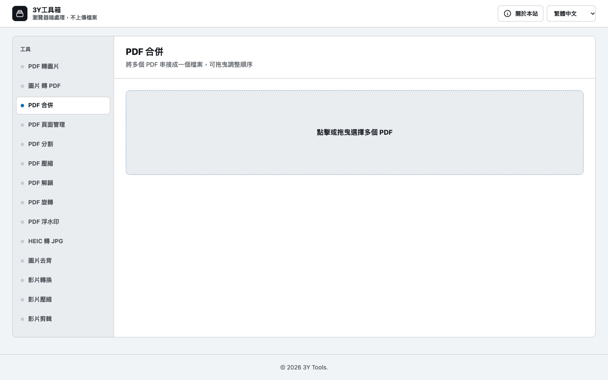

# 3Y 工具箱（YYPDFTools）

<p align="center">
  <strong>隱私優先、完全在瀏覽器中執行的 PDF、圖片與影片工具箱</strong>
</p>

<p align="center">
  繁體中文 ｜ <a href="README.en.md">English</a> ｜ <a href="README.ja.md">日本語</a>
</p>

<p align="center">
  
  
  
</p>

**[開啟 3Y 工具箱](https://yenyuy.github.io/YYPDFTools/)** · 免安裝，直接在瀏覽器使用。



## 專案簡介

3Y 工具箱是一套單頁式 PDF／圖片／影片處理工具。使用者選取的檔案會留在自己的裝置上，轉換、合併、壓縮、剪輯與重新輸出都由瀏覽器端 JavaScript 完成，不需要把檔案傳送到後端伺服器。

專案適合快速處理日常文件，也適合直接部署為靜態網站。介面支援繁體中文、英文與日文，並會依作業系統設定自動切換亮色或深色模式。

## 功能

| 工具 | 說明 | 輸出 |
| --- | --- | --- |
| PDF 轉圖片 | 將 PDF 每一頁轉成 JPG 或 PNG | 單張圖片或 ZIP |
| 圖片轉 PDF | 將多張 JPG／PNG 合併為一份 PDF | PDF |
| PDF 合併 | 合併多份 PDF，並可拖曳調整順序 | PDF |
| PDF 頁面管理 | 預覽、重新排序或刪除頁面，支援復原與還原原始頁面 | PDF |
| PDF 分割 | 簡單模式可切成兩份或逐頁拆分；進階模式可預覽頁面並自訂多個輸出範圍 | PDF 或 ZIP |
| PDF 壓縮 | 將頁面點陣化後，以可選畫質重建 PDF | PDF |
| PDF 解鎖 | 輸入已知密碼後，重建為無密碼 PDF | PDF |
| PDF 旋轉 | 逐頁即時預覽旋轉效果，將所有頁面順時針旋轉 90°、180° 或 270° | PDF |
| PDF 浮水印 | 自訂文字樣式、角度和排列，逐頁預覽並套用至全部或指定頁面，也可用黑色方框或筆刷遮蔽內容 | PDF |
| HEIC 轉 JPG | 將一張或多張 HEIC／HEIF 照片轉為 JPG | JPG |
| 圖片去背 | 使用瀏覽器內 AI 自動去背，並以擦除／還原筆刷精修 | 透明 PNG |
| 影片轉換 | 將影片轉為 MP4、WebM、MOV、MKV、AVI、TS、GIF 或常用音訊 | 影片、GIF 或音訊 |
| 影片壓縮 | 依畫質、最高解析度及 H.264／H.265／VP9 編碼重新壓縮 | MP4 或 WebM |
| 影片剪輯 | 預覽影片並以時間範圍精確截取片段 | MP4 |

PDF 浮水印支援無襯線、襯線與等寬字型，使用裝置上的字型繪製中文、日文等文字；重複排列可調整間距。未使用遮蔽時，浮水印會以影像疊層加入 PDF，保留原本可選取、搜尋的文字。所有處理都在本機完成。

頁面預覽預設為瀏覽模式，也可切換黑色方框或筆刷，以滑鼠或觸控手動遮蔽敏感內容，並調整筆刷大小。遮蔽會隨頁面保留，切換操作模式仍會套用，且每頁可復原或清空。只要任一頁有遮蔽，下載時就會先繪製浮水印，再套用不透明黑色遮蔽，將全部頁面影像化並建立新的 PDF；不複製來源文件的文字層、註解與表單物件、附件或中繼資料，輸出文字也將無法選取或搜尋。

其他介面特色：

- 繁體中文、English、日本語即時切換
- 拖放與檔案選擇器兩種匯入方式
- 依系統偏好自動套用亮色／深色模式
- 處理進度、成功通知與可復原的錯誤訊息
- 鍵盤焦點、語意化頁籤與動態狀態提示
- 寬螢幕桌面工具區隨視窗加寬，並支援行動版面

## 隱私與運作方式

所有檔案內容都在目前的瀏覽器分頁中處理。專案沒有上傳 API，也不需要建立帳號。

首次開啟會透過網路從 CDN 載入前端函式庫。若要部署離線版本，也需要將各工具按需載入的資源改為本機提供，例如 PDF.js 的背景工作程式、去背模型與 FFmpeg WebAssembly 核心。

圖片去背功能會在第一次使用時額外下載約 40 MB 的 AI 模型；模型會由瀏覽器快取，圖片內容不會傳送給模型主機或其他伺服器。

影片工具會在第一次處理時額外下載約 32 MB 的 FFmpeg WebAssembly 核心。影片內容只會寫入瀏覽器內的暫存檔案系統；處理完成後即清除。

> [!IMPORTANT]
> 「PDF 壓縮」與「PDF 解鎖」會把每一頁轉成影像後重建 PDF。這能在瀏覽器中完成處理，但輸出的文字將無法選取或搜尋。解鎖功能只適用於你已知原始密碼、且瀏覽器 PDF 引擎能讀取的文件。

## 使用方式

1. 開啟工具箱，從工具選單選擇功能。
2. 按一下檔案選取區，或將檔案拖放到該區域。
3. 依功能設定格式、頁碼範圍、畫質、密碼或旋轉角度。
4. 開始處理。完成後可下載結果，支援的格式也可直接在瀏覽器中預覽。

### PDF 頁面管理

1. 拖曳縮圖調整順序，或用觸控或鍵盤操作 **前移** 和 **後移** 按鈕。
2. 選取縮圖查看頁面，或按 **放大預覽** 開啟對話框。兩種預覽都可直接移動或刪除目前頁面。
3. 使用 **復原上一步** 或 **還原原始頁面** 修正編輯，並至少保留一頁。
4. 按 **下載編輯後的 PDF**，依目前順序另存新檔，例如 `report.pdf` 會另存為 `organized_report.pdf`。原有的可選取文字仍可選取與搜尋。

### PDF 分割與旋轉

- **PDF 分割** 的進階模式可透過縮圖確認每份 PDF 的頁碼範圍。各範圍須互不重疊，只有指定頁面會匯出。多份 PDF 會打包成 ZIP。
- **PDF 旋轉** 可選擇順時針旋轉 90°、180° 或 270°，再切換頁面檢查效果。下載時會將選定角度套用至整份 PDF。

### 編輯圖片去背與 PDF 浮水印

圖片去背與 PDF 浮水印的編輯器可展開或收合，按 Esc 可離開展開畫面。預覽以符合視窗的大小為 100%，可用 +／− 或 Ctrl／⌘ 加滾輪在 50% 至 800% 間縮放，並在瀏覽／手形模式拖曳移動。縮放與拖移不會改變輸出尺寸或遮蔽位置。

PDF 編輯器採用左側精簡懸浮工具列，筆刷粗細與操作說明收在設定側欄，讓低高度視窗或系統縮放後的 PDF 預覽保有較大的編輯空間。

浮水印選擇「重複鋪滿」時，可用 0–240 pt 的間距調整密度。傾斜排列沿著文字方向重複，並延伸至頁面邊緣；邊緣的部分文字可能裁切。預覽與匯出使用相同的排列。

## 技術組成

- HTML、CSS、原生 JavaScript
- [Tailwind CSS](https://tailwindcss.com/)（CDN）
- [PDF.js](https://mozilla.github.io/pdf.js/)：讀取與繪製 PDF 頁面
- [pdf-lib](https://pdf-lib.js.org/) 用於建立、合併、分割、旋轉和重新排列 PDF 頁面
- [JSZip](https://stuk.github.io/jszip/)：封裝多檔下載
- [FileSaver.js](https://github.com/eligrey/FileSaver.js/)：儲存瀏覽器產生的檔案
- [heic-to](https://github.com/hoppergee/heic-to)：HEIC／HEIF 轉 JPG
- [IMG.LY background-removal](https://github.com/imgly/background-removal-js)：透過 ONNX Runtime Web 與 WebAssembly 在瀏覽器內自動去背（AGPL-3.0）
- [ffmpeg.wasm](https://github.com/ffmpegwasm/ffmpeg.wasm)：瀏覽器內影片轉換、壓縮與剪輯（WebAssembly）

授權與上游原始碼資訊請見[第三方聲明](THIRD_PARTY_NOTICES.md)。

## 專案結構

```text
YYPDFTools/
├── index.html                 # 主要應用程式與預設入口
├── canvas-view-core.js        # 共用預覽適應大小、縮放與拖移工具
├── editor-focus.js            # 共用編輯器展開與收合行為
├── editor-focus.css           # 編輯器展開畫面樣式
├── pdf-split.js               # PDF 分割介面、縮圖與匯出流程
├── pdf-split-core.js          # 分割範圍的驗證與分組
├── pdf-rotate.js              # PDF 旋轉、即時預覽與匯出
├── pdf-rotate.css             # PDF 旋轉工作區樣式
├── pdf-watermark.js           # PDF 浮水印控制器與即時預覽
├── pdf-watermark-core.js      # 浮水印設定、排列與 PDF 幾何工具
├── pdf-organize.js            # PDF 頁面管理、縮圖與放大預覽
├── pdf-organize-core.js       # 頁面排序、刪除與匯出對應邏輯
├── pdf-organize.css           # 頁面管理工作區樣式
├── pdf-redaction-core.js      # 手動遮蔽座標、筆刷與影像繪製工具
├── pdf-watermark.css          # 浮水印工作區樣式
├── background-removal.js     # 自動去背與手動編輯器
├── background-removal-core.js # 可測試的編輯器工具函式
├── background-removal.css    # 去背工作區樣式
├── video-tools.js            # 共用 FFmpeg 引擎與三個影片工具
├── video-tools-core.js       # 可測試的影片命令與格式工具
├── video-tools.css           # 影片工作區樣式
├── vendor/ffmpeg/            # 本機託管的 ffmpeg.wasm JavaScript 包裝器
├── tests/                    # 瀏覽器工具的單元測試
├── PRODUCT.md                 # 產品定位與設計原則
├── README.md                  # 繁體中文（GitHub 預設顯示）
├── README.en.md               # English
├── README.ja.md               # 日本語
└── docs/images/
    ├── yyypdftools-desktop-zh-tw.jpg # 繁體中文桌面版截圖
    ├── yyypdftools-desktop-en.jpg    # 英文桌面版截圖
    └── yyypdftools-desktop-ja.jpg    # 日文桌面版截圖
```

## 瀏覽器需求與限制

- 建議使用最新版 Chrome、Edge、Firefox 或 Safari。
- 大型或高解析度 PDF 會使用較多記憶體。若瀏覽器分頁被系統終止，請減少頁數或分批處理。
- 加密 PDF 的支援程度取決於 PDF.js；部分加密方式可能無法在瀏覽器中解鎖。
- 點陣化壓縮較適合掃描型 PDF；以文字為主的 PDF 不一定會變小。
- HEIC 支援取決於瀏覽器與影像解碼套件的相容性。
- 自動去背需要支援 WebAssembly 的現代瀏覽器；第一次使用需下載 AI 模型。
- 影片處理需要 WebAssembly，且編碼速度通常慢於桌面版 FFmpeg；大型影片會使用較多記憶體，建議先以 750 MB 以下檔案操作。
- 影片剪輯器需要瀏覽器能預覽來源影片，建議使用 MP4、WebM 或 MOV。

## 貢獻

歡迎提交 Issue 或 Pull Request。修改功能時，請特別確認三種語言的文案、亮／暗色模式、鍵盤操作，以及桌面與行動版面皆能正常使用。

在專案目錄使用 Node.js 22 以上版本執行測試。

```sh
node --test tests/*.test.mjs
```

---

如果這個專案對你有幫助，歡迎在 GitHub 上給它一顆 ⭐。
